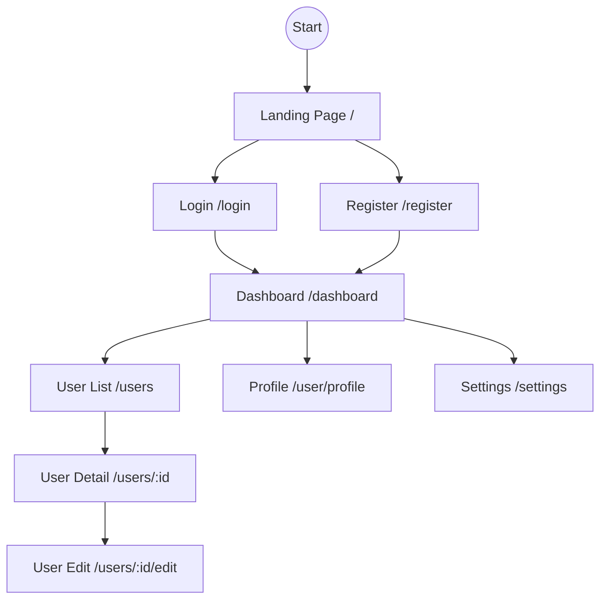

# Screen Transition Design

This document defines the screen flow and navigation structure.
It helps visualize user journeys and plan UI implementation.

## 1. Screen Flow Diagram (Example)

## 2. Authentication Flow

- **Guest**: `Landing` -> `Login` -> `Dashboard`
- **Authenticated**: `Landing` -> `Dashboard` (Redirect)
- **Unauthorized**: `Any Protected Route` -> `Login` (Redirect)

## 3. Navigation Components

- **Header/Navbar**: Global navigation (Logo, Links, User Menu).
- **Sidebar**: Context-aware navigation (Dashboard links, Categories).
- **Breadcrumbs**: Hierarchical location (Home > Users > User Name).

## 4. Role-Based Access Control (RBAC)

| Role  | Landing | Dashboard | User List | Settings | Admin Panel |
| :--- | :---: | :---: | :---: | :---: | :---: |
| Guest | ✅ | ❌ | ❌ | ❌ | ❌ |
| User  | ✅ | ✅ | ❌ | ✅ | ❌ |
| Admin | ✅ | ✅ | ✅ | ✅ | ✅ |

## Verification Checklist

- [ ] **Completeness**: Are all planned screens defined?
- [ ] **Flow**: Is the transition logical (no dead ends)?
- [ ] **Authorization**: Are protected routes correctly guarded (Middleware)?
- [ ] **Consistency**: Are common navigation elements (Header/Sidebar) used consistently?