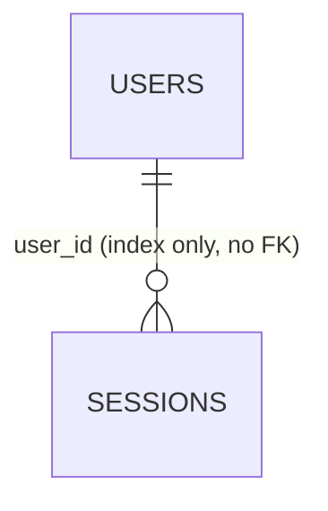

# Database Design Specification (ER + Table Definitions)

## 1. Purpose

This document defines:

- Canonical database design rules for this project
- Current production schema (ER diagram + table definitions)
- Practical policies for naming, indexes, and relational constraints

This is intended to be the baseline for new tables and migration reviews.

## 2. Scope And Source Of Truth

- Primary source of schema truth: `database/migrations/`
- Runtime validation source: `SHOW CREATE TABLE` in local MariaDB
- Scope of this document:
  - App domain tables
  - Auth/support tables used by Laravel/Fortify
  - Infra tables currently present in migrations
- Notes:
  - Queue tables (jobs, job_batches, failed_jobs) were removed by `2026_02_21_000000_drop_queue_tables.php`.

## 3. Naming Conventions

### 3.1 General

- Table names: `snake_case`, plural nouns (`users`, `sessions`)
- Column names: `snake_case`
- PK column name: `id`
- FK column name: `<referenced_singular>_id` (`user_id`)
- Timestamp suffix:
  - lifecycle timestamps: `_at` (`created_at`, `updated_at`)
- Boolean prefix:
  - `is_` / `has_`

### 3.2 Constraint/Index Naming

- Primary key: implicit `PRIMARY`
- Regular index: `{table}_{column}_index`
- Unique index: `{table}_{columns}_unique`
- Foreign key constraint: `{table}_{column}_foreign`

## 4. Data Type Policy

- Entity primary keys: `bigint unsigned` auto-increment (default)
- Foreign keys: `bigint unsigned` matching referenced PK type
- Text:
  - bounded text: `varchar(n)`
  - unbounded/free-form: `text` / `longtext`
- Time:
  - current baseline: `timestamp`
- Charset/collation: `utf8mb4` / `utf8mb4_unicode_ci`

## 5. Index Policy

## 5.1 Required Indexes

- Every table must have a primary key.
- Every foreign key column must have an index.
- Business uniqueness must be protected with unique indexes.

## 5.2 Query-Driven Indexes

- Add indexes for high-frequency filter/sort columns.
- Avoid indexes that are not tied to concrete query patterns.
- Avoid indexing low-cardinality boolean columns alone unless query volume and selectivity justify it.

## 6. Relationship Constraint Policy

Choose `ON DELETE` action by data lifecycle:

- `CASCADE`: child rows have no meaning without parent
- `SET NULL`: historical/financial record should survive parent deletion
- `RESTRICT`: master/reference data must not be deleted while referenced

Additional rules:

- If a relation is modeled without FK (e.g., polymorphic or session linkage), document integrity ownership clearly at application layer.
- Non-null FK should be default unless business requirements explicitly allow orphaning.

## 7. ER Diagram (Current Schema)



## 8. Table Definitions (Current Schema)

## 8.1 Domain Tables

### `users`

Purpose:

- User master.

Columns:

| Column                       | Type           | Null | Default | Notes                     |
| ---------------------------- | -------------- | ---- | ------- | ------------------------- |
| `id`                         | `bigint unsigned` | No | auto_increment | PK                 |
| `name`                       | `varchar(255)` | No   | -       | Display name              |
| `email`                      | `varchar(255)` | No   | -       | Mail address              |
| `email_verified_at`          | `timestamp`    | Yes  | `NULL`  | Verification timestamp    |
| `password`                   | `varchar(255)` | No   | -       | Hashed password           |
| `two_factor_secret`          | `text`         | Yes  | `NULL`  | 2FA secret (Fortify)      |
| `two_factor_recovery_codes`  | `text`         | Yes  | `NULL`  | 2FA recovery codes        |
| `two_factor_confirmed_at`    | `timestamp`    | Yes  | `NULL`  | 2FA confirmation          |
| `remember_token`             | `varchar(100)` | Yes  | `NULL`  | Remember-me token         |
| `created_at`                 | `timestamp`    | Yes  | `NULL`  | Created timestamp         |
| `updated_at`                 | `timestamp`    | Yes  | `NULL`  | Updated timestamp         |

Indexes/constraints:

- `PRIMARY KEY (id)`
- `UNIQUE users_email_unique (email)`

## 8.2 Auth/Support Tables

### `password_reset_tokens`

Purpose:

- Password reset token store keyed by email.

Columns:

| Column       | Type           | Null | Default | Notes             |
| ------------ | -------------- | ---- | ------- | ----------------- |
| `email`      | `varchar(255)` | No   | -       | PK                |
| `token`      | `varchar(255)` | No   | -       | Reset token       |
| `created_at` | `timestamp`    | Yes  | `NULL`  | Created timestamp |

Indexes/constraints:

- `PRIMARY KEY (email)`
- No FK to `users` (intentionally decoupled)

---

### `sessions`

Purpose:

- Laravel database session storage.

Columns:

| Column          | Type           | Null | Default | Notes              |
| --------------- | -------------- | ---- | ------- | ------------------ |
| `id`            | `varchar(255)` | No   | -       | PK                 |
| `user_id`       | `bigint unsigned` | Yes | `NULL` | Session owner      |
| `ip_address`    | `varchar(45)`  | Yes  | `NULL`  | IPv4/IPv6          |
| `user_agent`    | `text`         | Yes  | `NULL`  | User agent         |
| `payload`       | `longtext`     | No   | -       | Serialized session |
| `last_activity` | `int`          | No   | -       | Unix timestamp     |

Indexes/constraints:

- `PRIMARY KEY (id)`
- `INDEX sessions_user_id_index (user_id)`
- `INDEX sessions_last_activity_index (last_activity)`
- No FK to `users` by Laravel default

## 8.3 Infra Tables

### `cache`

| Column       | Type           | Null | Default | Notes          |
| ------------ | -------------- | ---- | ------- | -------------- |
| `key`        | `varchar(255)` | No   | -       | PK             |
| `value`      | `mediumtext`   | No   | -       | Cached payload |
| `expiration` | `int`          | No   | -       | Unix timestamp |

Indexes/constraints:

- `PRIMARY KEY (key)`

---

### `cache_locks`

| Column       | Type           | Null | Default | Notes          |
| ------------ | -------------- | ---- | ------- | -------------- |
| `key`        | `varchar(255)` | No   | -       | PK             |
| `owner`      | `varchar(255)` | No   | -       | Lock owner     |
| `expiration` | `int`          | No   | -       | Unix timestamp |

Indexes/constraints:

- `PRIMARY KEY (key)`

---

### `migrations`

| Column      | Type           | Null | Default        | Notes                |
| ----------- | -------------- | ---- | -------------- | -------------------- |
| `id`        | `int unsigned` | No   | auto_increment | PK                   |
| `migration` | `varchar(255)` | No   | -              | Migration class/file |
| `batch`     | `int`          | No   | -              | Batch number         |

Indexes/constraints:

- `PRIMARY KEY (id)`

## 9. Migration Design Checklist (For New Tables)

1. Table/column names follow `snake_case` and domain vocabulary.
2. PK/FK types match referenced tables exactly (`bigint unsigned`).
3. `ON DELETE` action is explicitly chosen and justified.
4. Indexes are tied to query patterns and FK/unique requirements.
5. Nullable columns are intentional and explained in PR description.
6. Column comments are added for domain-specific fields.
7. Rollback (`down`) path is safe and reversible.
8. Verification runs successfully after migration updates.

## 10. Verification Commands

When schema-related code changes are made (`.php` migrations/models/repositories):

```bash
mise run test
pnpm test:e2e --project=chromium
```

If frontend is also modified, use the full combined verification set from `docs/infrastructure/commands.md`.
